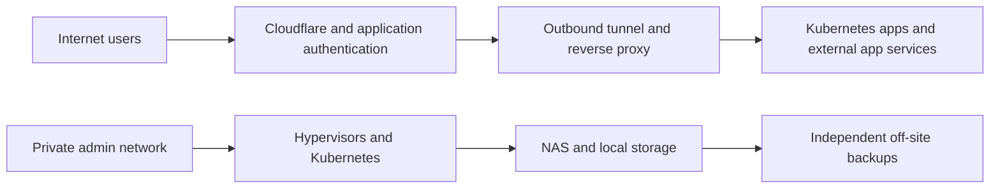
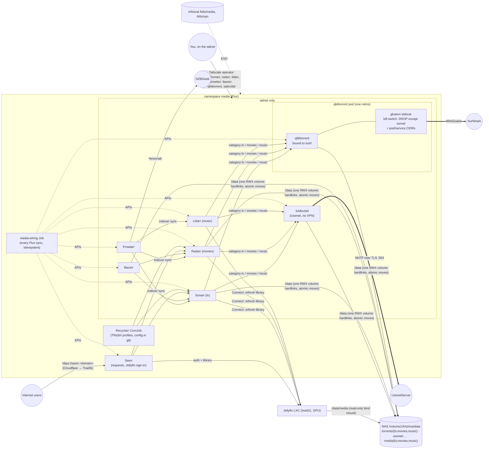

# artzima-iac

> **Public reference configuration:** all addresses, MACs and project identifiers here are fictional examples. Actual device-role assignments and deployment metadata live in private configuration. Live make targets automatically use an ignored deployment copy. See [private deployment configuration](docs/PRIVATE-CONFIG.md).

> **Operator: start with [`docs/OPERATOR-SETUP.md`](docs/OPERATOR-SETUP.md).** It is THE ordered
> checklist of everything you do by hand (five root credentials, the NAS, USB boots, first logins);
> everything else is `make preflight`, `make bootstrap`, `make up`, `make verify`.

Infrastructure as code for the **artzima** homelab. It rebuilds everything from bare metal,
from USB installs through to running apps:

| Layer | Tool | Where |
|---|---|---|
| OS install (Proxmox VE ×4, PBS ×1) | Proxmox automated installer + answer server | [`install/`](install/README.md) |
| Host config, cluster, QDevice, storage, backups, UPS, Tailscale, API token | Ansible | `ansible/` |
| VMs/LXCs: Talos ×3, Jellyfin, Tailscale routers ×2; Talos bootstrap | OpenTofu (bpg/proxmox, siderolabs/talos) | `tofu/` |
| Kubernetes platform and apps | Flux + Helm | `k8s/` |
| Media stack: Prowlarr, Sonarr, Radarr, Lidarr, Bazarr, qBittorrent (only via Surfshark, gluetun sidecar), SABnzbd (Usenet: UsenetServer + NZBGeek), Seerr, Recyclarr; wired to the Jellyfin LXC | Flux + app-template, one idempotent wiring Job | `k8s/apps/media/` ([below](#media-stack)) |
| Paperless-ngx (**tailnet only**: `http://paperless`) with Valkey, Tika, Gotenberg, CNPG Postgres; nightly `document_exporter` | Flux + app-template, CNPG, CronJob | `k8s/apps/paperless/` ([manual steps §13](docs/manual-steps.md#13-paperless-ngx)) |
| Off-site backups to Backblaze B2: buckets + scoped keys (OpenTofu), Postgres WAL/base (CNPG Barman Cloud plugin), volumes (VolSync restic), PBS (S3 datastore), NAS media + personal shares (Backrest/restic **on the NAS**) | OpenTofu, Flux, Ansible | `tofu/backblaze/`, `k8s/apps/backups/`, [`docs/backups.md`](docs/backups.md) |
| Vaultwarden (`vault.<domain>`, never behind Access; `/admin` tailnet-only) on its own CNPG Postgres, nightly snapshot + encrypted NAS backup | Flux + app-template, CNPG, CronJob | `k8s/apps/vaultwarden/` ([manual steps §12](docs/manual-steps.md#12-vaultwarden)) |
| Publishing every app (one Traefik behind one Cloudflare Tunnel) | `/apps.yaml` → generated Traefik routes + OpenTofu (cloudflare/cloudflare) + cloudflared in k8s | `apps.yaml`, `tofu/cloudflare/`, `k8s/apps/routes/`, `k8s/infrastructure/controllers/{traefik,cloudflared}.yaml` |
| Private app images (alexandria, skyjo) | GitHub Actions → **private** GHCR packages, pulled with a secret synced from Infisical | [`images/`](images/README.md), private builder workflow template |
| Secrets (none in git, not even encrypted) | **Infisical** → Ansible lookups, OpenTofu provider (ephemeral), External Secrets Operator | [`docs/secrets.md`](docs/secrets.md), `k8s/secrets/` |
| Derived credentials (Tailscale auth keys, the cluster's Infisical identity) from five root credentials | OpenTofu (tailscale, infisical) + `make gen-secrets` | `tofu/bootstrap/`, `scripts/gen_secrets.py` |
| Gates and self-checks: preflight, confirmations, monthly restore tests, alerts to one webhook | make, CronJobs, Alertmanager | `scripts/preflight.py`, `scripts/verify.py`, `k8s/apps/backups/maintenance.yaml`, `k8s/infrastructure/configs/alerts.yaml` |
| Public-repo guards, CI, dependency updates | gitleaks, `make lint` on every PR, Renovate | `.gitleaks.toml`, `.github/workflows/{ci,security}.yml`, `renovate.json` |
| Things that can't be automated | Docs | [`docs/manual-steps.md`](docs/manual-steps.md) |

Design rationale: [`docs/decisions.md`](docs/decisions.md). Backups: [`docs/backups.md`](docs/backups.md).
Server evolution and dated decisions: [`docs/JOURNAL.md`](docs/JOURNAL.md).
**Total or partial loss: [`docs/disaster-recovery.md`](docs/disaster-recovery.md)**, a runbook the
operator executes alone from a blank laptop (`scripts/dr-tools.sh`), printed with `make dr-pdf` into the
emergency kit that must exist outside the lab (`make emergency-kit`).

> **This repository is public.** It contains no secrets and no personal data:
> secrets, the real domain, email addresses, SSH keys and Cloudflare IDs live in
> Infisical ([`docs/secrets.md`](docs/secrets.md)). Run `make hooks` once, and
> `make check-public` before every push.

## Private deployment source of truth

- **`.private/site/ansible/hosts.yml`** holds every machine and guest: name, MAC, role, Proxmox node, and
  `host_index`.
- **`.private/site/ansible/group_vars/all/network.yml`** holds `lab_subnet`, `lab_gateway`, `lab_vlan_id`, `lab_dns`,
  `lab_domain`, and the k8s API VIP offset. It also holds the documentation-only plan for the
  Firewalla LAN: `lab_dhcp_pool`, the unmanaged lab addresses (`lab_unmanaged`: admin workstation,
  a reserved address), and the home network on its WAN side (`home_subnet`).
- **`.private/site/ansible/group_vars/all/lab.yml`** holds cluster and datastore names, timezone, the NAS
  export.
- **`.private/site/ansible/group_vars/all/infisical.yml`** says where the secrets are: the Infisical host
  (default `https://app.infisical.com`), the two projects (main, and the cluster's own project, which
  holds only `/k8s/**`) and the environment.
- **`apps.yaml`** (repo root) holds the list of published apps (name, namespace, Service, port).
  Every app is `https://<name>.<domain>`, where the domain is the Infisical secret
  `/settings/PUBLIC_DOMAIN`. This one list drives the Traefik routes, the Cloudflare tunnel
  rules, DNS records and Access.

Live make targets copy the public code into `.private/runtime`, overlay these private files, and regenerate local outputs. The root `ansible/` files are fictional CI examples. Back up changes with `make private-backup`.

Every IP is `cidrhost(lab_subnet, host_index)`. Each consumer reads these
files directly:

| Consumer | How it reads them |
|---|---|
| Ansible | `group_vars/all/derived.yml` (`ansible.utils.nthhost`) |
| OpenTofu | `tofu/locals.tf` (`yamldecode` + `cidrhost`) |
| Answer files | `install/render_answers.py` (`scripts/labdata.py`) |
| Flux | Private `cluster-vars` ConfigMap, applied by `make runtime-config`, used via `postBuild.substituteFrom` (plus the ESO-made Secret `cluster-secret-vars` for `${public_domain}`) |

No address is written anywhere else. `make lint` fails if `cluster-vars.yaml` is out of date.



This diagram shows software relationships only. Actual device assignments, addresses,
UPS wiring and the physical topology are private. The CI inventory is fictional.


## Repository layout

```
install/      answer-file renderer, answer server (stdlib), first-boot hook, ISO prep
ansible/      hosts.yml, group_vars/, roles/, playbooks/ (site.yml runs them in order)
tofu/         Talos VMs + bootstrap, Jellyfin LXC, ts-router LXCs
              tofu/cloudflare (tunnel, DNS, Access), tofu/backblaze (B2 buckets + scoped keys),
              tofu/bootstrap (Tailscale auth keys + the ESO identity, derived from root credentials)
k8s/          clusters/artzima (Flux entry), infrastructure/ (incl. external-secrets), apps/,
              secrets/ (ClusterSecretStore + ExternalSecrets: Infisical paths only)
images/       build definitions for the private app images (alexandria: upstream pin + CLI; skyjo: Dockerfile with LFS weights)
.github/      workflows/ci.yml (make lint on every PR), security.yml (gitleaks)
scripts/      labdata/render helpers, validate_k8s.py, install-tools.sh, infisical_exec.py,
              preflight.py, verify.py, gen_secrets.py, confirm.sh (the "yes" gate),
              dr-tools.sh (DR laptop tools), dr_pdf.py, dr_secrets_from_cluster.py,
              eso_bootstrap.py, check_public.sh, install-git-hooks.sh,
              media-adopt.sh (hardlink existing rips into the media layout)
docs/         OPERATOR-SETUP.md (start here), secrets.md, manual-steps.md, decisions.md, backups.md,
              disaster-recovery.md, JOURNAL.md (server evolution)
emergency-kit.yaml, secrets.manifest.yaml   names only: what lives outside the lab / in Infisical
renovate.json  dependency updates (patch/digest automerge after CI, majors need approval)
```

## One-time setup on the workstation

`make deps` (pinned tools into `~/.local/share/artzima-tools`, no sudo) and `make hooks` (gitleaks
pre-commit). Everything else, including Infisical and the five root credentials, is in
[`docs/OPERATOR-SETUP.md`](docs/OPERATOR-SETUP.md) section A.

## NAS storage and retention

The IaC stack creates application storage within the configured NAS export. Persistent
volumes use `Retain`; deleting a PVC does not delete its files. Media adoption creates
hardlinks without moving, renaming or deleting source rips. Personal backup sources are
mounted read-only. Actual NAS paths and source selections belong in private configuration.

**Where this repo writes on the NAS: only inside `/volume1/Artzima`**

| Path | Writer |
|---|---|
| `dump/`, `template/`, `snippets/` | Proxmox storage `artnas` (`make storage`: content `backup,iso,vztmpl,snippets`, never VM/CT disks). Nightly backups go to PBS, not here |
| `k8s/` | the `nfs-artnas` StorageClass (`Retain`), incl. CNPG volume-snapshot tarballs |
| `paperless/{data,media,consume}/` | Paperless-ngx (static PVs, `Retain`); it removes files from `consume/` once it has imported them |
| `backups/paperless/` | the nightly `document_exporter` (static PV, `Retain`), an incremental mirror; `--delete` removes **only** files of documents deleted in Paperless, inside this folder |
| `backrest/` | Backrest on the NAS (`make nas-backup`): config, data, cache, and `restore/` (its only writable restore target) |
| `backups/vaultwarden/` | the Vaultwarden backup CronJob (static PV, `Retain`): encrypted dumps; it rotates **only its own** `vaultwarden-*.gpg` files |
| `data/` | the static media PV (`Retain`), the `media-wiring` Job (folder tree, `.recycle/`), Sonarr/Radarr/qBittorrent, and `make media-adopt` (links under `data/media/`) |

The Jellyfin host mount of `data/` is **read-only**. This is enforced, not just documented:
- `scripts/labdata.py` refuses any NAS sub-folder that is absolute, contains `..` or is empty.
- `make lint` fails on any NFS StorageClass, PV or snapshot class whose path is outside
  `/volume1/Artzima`, or that isn't `Retain`.
- `media-adopt.sh` refuses a data folder that resolves outside the root.
- Nothing deletes on the NAS, with narrow exceptions inside its own folders: the Vaultwarden backup
  job rotates its old `vaultwarden-*.gpg` files, the Paperless exporter mirrors deletions into
  `backups/paperless/`, and Paperless empties `consume/`. Deleting a PVC leaves a `Released` PV and its folder
  ([manual steps §11](docs/manual-steps.md#11-nas-volume-lifecycle)).

## Deployment workflow

Four commands; [`docs/OPERATOR-SETUP.md`](docs/OPERATOR-SETUP.md) says what you do around them.
Every step that changes something shows its plan (`tofu plan`, the playbook's hosts and tasks,
the Infisical key names) and waits for `yes` (`AUTO_APPROVE=1` = no questions).

| Phase | `make` | What happens |
|---|---|---|
| 0 | `preflight` | **Refuses** unless every `by: operator` key exists in Infisical (names only), every Proxmox/PBS host answers on SSH with the inventory MAC and install-disk serial, and the NAS exports `/volume1/Artzima`. Read-only. `PREFLIGHT_ARGS=--accounts-only` = only Infisical |
| 1 | `bootstrap` | Infisical folders; `gen-secrets` (every missing random secret, straight into Infisical); `ids-apply` (Tailscale auth keys + the read-only ESO identity); `b2-apply` (buckets, a backup key and a maintenance key per bucket); `cf-apply` (tunnel, DNS, Access, tunnel token). Doesn't touch the lab |
| 2 | `up` | `preflight`, then `site` (all host playbooks: common, network, cluster + QDevice, PBS (writes `PBS_FINGERPRINT`), storage, NUT, Tailscale, GPU, Proxmox API tokens) → `tofu-apply` (Talos VMs, Jellyfin LXC, ts-routers; kubeconfig into `tofu/out/`) → `lxc-devices` → `ts-routers` → `jellyfin` → `pbs-offsite` → `nas-backup` → `eso-bootstrap` → `flux-bootstrap` |
| 3 | `verify` | Read-only report: nodes, Flux Kustomizations + HelmReleases, ExternalSecrets, PVCs, certificates, CNPG + VolSync backups < 26 h, last restore self-checks, every public URL |

Before phase 2 the machines are installed from USB (`make answers`, `install/prepare-iso.sh`,
`make answer-server`, [install/README.md](install/README.md)); the answer server only answers known
MACs and installs onto the disk with the inventory serial. Every target also runs alone
(`make help`), and every playbook is idempotent.

### Private app images (GHCR)

`alexandria` and `skyjo` are the operator's own apps. Their images are **private**
GHCR packages built in a separate **private builder repository**. This public repository
contains build definitions and a guarded workflow template at
`images/private-builder/images.yml`; it does not publish application images. The app repos
are not modified:

| Image | Built from | Pin |
|---|---|---|
| `ghcr.io/devartech/alexandria-mcp` | upstream `Dockerfile` (git context) | `images/alexandria/upstream.env` |
| `ghcr.io/devartech/alexandria-oauth-proxy` | upstream `proxy/Dockerfile` (git context `:proxy`) | same |
| `ghcr.io/devartech/alexandria-cli` | [`images/alexandria-cli/Dockerfile`](images/alexandria-cli/Dockerfile): upstream's **release** binary `alexandria` (sha256-pinned; CI checks the release tag is the pinned commit), for `alexandria init` | same (`UPSTREAM_CLI_VERSION`, `UPSTREAM_CLI_SHA256`) |
| `ghcr.io/devartech/skyjo` | [`images/skyjo/Dockerfile`](images/skyjo/Dockerfile) (clones skynet at the pin **with Git LFS**: the MuZero weights are in the image; API + frontend on one origin) | `images/skyjo/upstream.env` |

- **When:** in the private builder, on a push to `main` that touches `images/**` or the workflow, every Monday
  (refreshes base images at the same pin), and by hand (*Actions → images → Run workflow*,
  optionally with another upstream ref).
- **Tags:** the resolved upstream commit SHA, plus `latest`. The HelmReleases pin the SHA tag.
- **Bumping an app:** change the pin in the private builder, synchronise its public pin, wait for the
  workflow, then set the same SHA as the image tag in `k8s/apps/<app>/helmrelease.yaml`.
- **Pulling:** every pod of both apps has `imagePullSecrets: [ghcr-pull]`. ESO's
  `ClusterExternalSecret` (`k8s/secrets/ghcr-pull.yaml`) creates that `dockerconfigjson` in every
  namespace labelled `artzima.io/ghcr-pull: "true"` (alexandria, skyjo) from Infisical
  `/k8s/ghcr` (a classic PAT with only `read:packages`;
  [manual steps §7](docs/manual-steps.md#7-private-images-ghcr-pat-and-pull-secret)).
  If you add a namespace that uses these images, give it that label.
- Details and local builds: [`images/README.md`](images/README.md). Why private GHCR, and the
  fully in-cluster alternative: [decisions](docs/decisions.md#private-app-images-on-ghcr).

### Alexandria library and Skyjo model storage

- **Alexandria starts with an empty library.** The server (`alexandria-mcp`) refuses to start
  without an initialized library, and the upstream image has no CLI. So the pod's `init-library`
  initContainer (image `alexandria-cli`, upstream's release binary of the same commit) runs
  `alexandria init /srv/alexandria`, but only if `/srv/alexandria/.alexandria` doesn't exist.
  `init` refuses to overwrite an existing library, and the guard makes the pod restartable.
  It writes the default `.alexandria/config.toml` (in-process **fastembed** embedder) and the tier
  folders on the PVC (`/volume1/Artzima/k8s/alexandria/alexandria-library`). Nothing to do by
  hand; check with `kubectl -n alexandria logs deploy/alexandria-mcp -c init-library`
  ("Initialized Alexandria library at /srv/alexandria" the first time, "library exists" after
  that). Another embedder: [manual steps §8](docs/manual-steps.md#8-alexandria-secrets-library-first-login-embedder).
  To start over: delete the PVC's contents on the NAS (or the PVC plus its folder; the class is
  `Retain`) and restart the pod.
- **Skyjo is stateless.** The weights come from source control: DevArtech/skynet keeps them
  in **Git LFS** (`runs/muzero_baseline/checkpoints/checkpoint.pt`,
  `runs/muzero_belief/checkpoints/checkpoint.pt`, ~0.4 GB together).
  - **Build:** the image build fetches exactly those two objects with `git lfs pull` and **fails**
    unless each is a real file. That means not a ~134-byte pointer, at least 1 MiB, and its
    sha256 equal to the pointer's oid.
  - **Lookup:** upstream's default lookup globs `checkpoint_iter_*.pt`, so the image adds
    `checkpoint_iter_1.pt → checkpoint.pt` in each folder and asserts that the lookup finds a
    real checkpoint. No volume.
  - **New weights:** commit them upstream (LFS), bump `UPSTREAM_REF`, and set the new image tag.
  - **LFS bandwidth:** [decisions](docs/decisions.md#private-app-images-on-ghcr).

### Bootstrap Flux

`make up` ends with these two. `make eso-bootstrap` creates
`external-secrets/infisical-universal-auth` from the `artzima-eso` identity that `make bootstrap`
created (Infisical `/tofu/ESO_CLIENT_*`). That is the only imperative secret in the cluster; it is
piped to kubectl on stdin and never written to disk or git. Then `make flux-bootstrap` runs
`flux bootstrap github --path=k8s/clusters/artzima` with the GitHub PAT from Infisical
(`/k8s/ghcr/GHCR_PULL_TOKEN`) in memory; flux creates a read-only deploy key and stores nothing
else. Flux applies the following, in order:
`namespaces → external-secrets (ESO) → secrets (ClusterSecretStore + ExternalSecrets, waits
until all are synced from Infisical) → infra-controllers → infra-configs → apps`.

### How a request reaches an app

`https://<app>.<domain>` → Cloudflare edge (TLS, optional Access) → tunnel →
one of the 2 `cloudflared` pods → `http://traefik.traefik.svc.cluster.local:80` →
Traefik matches the Host header against the app's generated IngressRoute →
the app Service. For Jellyfin (the only app outside Kubernetes), that Service is a selector-less
Service with an EndpointSlice pointing at the LXC's lab IP.
Nothing on the LAN listens for the internet, and neither router (the Firewalla in front of the
lab, the Xfinity in front of it) has port forwards. Admin access (Proxmox, SSH, talosctl,
kubectl) goes over Tailscale, or from the admin workstation's wired lab NIC. Home devices
reach the lab and the NAS only over Tailscale ([manual steps §4a](docs/manual-steps.md#4a-reaching-the-lab-from-the-home-network)).

**Adding an app:** deploy it (a HelmRelease with its chart ingress **disabled**), then add **one
entry** to `/apps.yaml` (name, namespace, Service, port). After that:
`make render` (generates its Traefik IngressRoute), `make cf-plan cf-apply` (tunnel rule + DNS),
then commit and push. `make lint` checks that the Service and port exist and that nothing else publishes routes.

**Optional LAN shortcut:** Traefik is ClusterIP-only by default, so LAN clients also go
through Cloudflare. To reach Traefik directly on the LAN, see the commented
option in `traefik.yaml` and [decisions](docs/decisions.md#one-reverse-proxy-behind-one-cloudflare-tunnel).

## Media stack

An "arr" stack in Kubernetes (`k8s/apps/media`, namespace `media`) that feeds the Jellyfin LXC.
Design and trade-offs: [decisions](docs/decisions.md#media-stack-arr--qbittorrent-via-surfshark--seerr).
Every step: [manual steps §10](docs/manual-steps.md#10-media-stack-arr--qbittorrent--seerr).



**Order of operations** (inside the main table: steps 0, 12, 14a, 16, 20):

1. **NAS:** create `/volume1/Artzima/data/{torrents,media}/{tv,movies,music}`, `chown -R 1000:1000`,
   dirs `2775` ([§3](docs/manual-steps.md#3-ugreen-nas-ugos)). Then `make lxc-devices` mounts
   `media/` read-only into the Jellyfin LXC at `/data/media`.
2. **Surfshark:** generate a WireGuard key pair (*Manual setup → WireGuard*), and put the private key
   and the `Address` into Infisical `/k8s/vpn` ([§10.1](docs/manual-steps.md#101-before-the-flux-sync-in-this-order)).
   Pick the country in `ansible/group_vars/all/media.yml`.
3. **Keys:** generate the arr/Seerr API keys and the qBittorrent login into `/k8s/media`
   (`make gen-secrets`). The **Jellyfin API key** is created by `make jellyfin` and written to
   `/k8s/media/JELLYFIN_API_KEY`, along with copies of the Jellyfin admin login
   (`/k8s/media/JELLYFIN_ADMIN_*`, for Seerr). Run `make secrets-check`.
4. **Flux sync:** `make render`, `make cf-plan cf-apply` (adds `seerr.<domain>`), commit, push.
   Flux deploys the stack, and the `media-wiring` Job connects everything: download client, root
   folders, Prowlarr apps, Bazarr, Jellyfin Connect, and Seerr's whole setup (Jellyfin sign-in,
   libraries, application URL, Sonarr/Radarr): no setup wizard by hand.
5. **After:** verify the VPN IP, run Recyclarr once, first logins
   ([§10.2-10.3](docs/manual-steps.md#102-after-the-sync)).
6. **Existing rips** (any time after step 1): [below](#bringing-in-your-existing-rips).

### Bringing in your existing rips

The operator's ripped movies and TV shows already on the NAS **must never be lost**. They may
be reorganised, but only like this: every file gets a second name (a **hardlink**, same inode,
no extra space) inside the media layout. Sonarr, Radarr and Jellyfin then use those names, and the
**originals are never moved, renamed, re-permissioned or deleted**. Even if an app deleted its
copy, the bytes would still be there under the original path, and the arrs' recycle bin
(`/data/.recycle`, `media_recycle_days`) keeps their deletes too.

1. **Power the NAS on** and make sure the SSH service is enabled (UGOS control panel). Your
   NAS user (`devartech`) needs `sudo` (UGOS admins have it; it asks for the password).
2. **Inspect, read-only.** Find the rips and check which filesystem they are on:
   ```bash
   ssh devartech@192.0.2.156
   ls -la /volume1/ ; df -h /volume1/*                    # shared folders and volumes
   sudo find /volume1 -maxdepth 4 -type d \( -iname '*movie*' -o -iname '*film*' -o -iname '*tv*' -o -iname '*show*' -o -iname '*series*' \) 2>/dev/null
   stat -c '%d %n' /volume1/Artzima /volume1/*/          # same first number = same filesystem
   sudo btrfs subvolume list /volume1 2>/dev/null | head  # UGOS shares are often separate subvolumes
   ```
   Hardlinks only work inside **one** filesystem, and this repo only ever **writes** inside
   `/volume1/Artzima` ([NAS storage and retention](#nas-storage-and-retention)). If the rips are in
   another shared folder with a different `%d`, the script refuses. You then decide:
   - **(a)** a **verified copy** straight into `/volume1/Artzima/data/media/{movies,tv}`. It only
     reads the other share, writes only into Artzima, and needs the space twice. The script prints
     the `rsync` copy and the checksum-verify command (which must print nothing). No adoption run is
     needed after that; step 7 imports the copies the same way.
   - **(b)** **moving** the rips into the Artzima share yourself, in UGOS. That is your own
     decision about your own share; the repo never does it.
3. **Set `media_existing_paths`** in `ansible/group_vars/all/media.yml`. One entry per library
   root, whose **children** are the title folders (`Movie (Year)/…`, `Show/Season 01/…`,
   `Artist/Album/…`):
   ```yaml
   media_existing_paths:
     - { path: /volume1/Artzima/Movies, kind: movies }
     - { path: /volume1/Artzima/TV Shows, kind: tv }
     - { path: /volume1/Artzima/Music, kind: music }   # children = artist folders
   ```
   Commit it (`make render` is not needed; no rendered file uses it).
4. **Dry-run:** `make media-adopt`. It only reads (find/stat/du). For each source it shows the
   filesystem check, file and folder counts, the total size, what it would link, and warnings: loose
   files that aren't in a title folder, symlinks (skipped), files that aren't world-readable
   (Jellyfin reads as "other"; fixing that means `chmod o+r` on the originals, which is your call).
5. **Apply:** `make media-adopt MEDIA_ADOPT_ARGS=--apply`. It creates the folders (owned by
   `media_puid:media_pgid`, `2775`) and one hardlink per file under
   `<data>/media/{movies,tv}/<same relative path>` (loose movie files: `<name>/<file>`, step 7). It never overwrites: a different file already at a
   destination is reported as a **conflict** and skipped. Re-running is safe.
6. **Verify:** the apply run ends each source with the counts and sizes of the originals and the
   links, the combined disk usage (hardlinks are counted once, so it equals the originals), and
   `VERIFIED: all N originals have a link with an equal inode`. Anything else exits non-zero and
   lists every original without a link. The dry-run afterwards shows `already linked: N`.
7. **Import in the arrs: automatic.** The `media-wiring` Job (every Flux sync, or right away:
   `kubectl -n media delete job media-wiring && flux reconcile kustomization apps --with-source`)
   imports the folders of `/data/media/{movies,tv}` that Radarr/Sonarr don't manage yet
   (**music** is imported by hand in Lidarr, then protected the same way:
   [manual steps §10.8](docs/manual-steps.md#108-existing-music-lidarr)):
   - **Unrenamed:** "Rename Movies/Episodes" is off and permissions are never set.
   - **Matched only when unambiguous:** an id in the folder name (`{tmdb-603}`, `[tvdbid-79126]`,
     `{imdb-tt0133093}`), or an exact title + `(Year)`, or a unique exact title.
   - **Protected:** tagged `owned-rip`, quality profile **"Owned rip"** (any quality, **upgrades
     not allowed**), and **unmonitored** (movies; for series every episode that has a file).
     This is re-enforced on every run for every `owned-rip` title.
   - **Unmatched folders** are listed in the Job log. Import those by hand: *Library Import* in
     Radarr/Sonarr, choose the root folder, profile **Owned rip**, monitor **None**, tag
     **owned-rip**. Use *Manual Import* for odd layouts, and **never** "Move"; Radarr/Sonarr then
     only point at the existing link.
   - **Loose movie files** in a source root (no title folder) are handled by the script: a video
     `<name>.mkv` is linked as `movies/<name>/<name>.mkv`, and its sidecars (`<name>.en.srt`, `<name>.nfo`)
     join it. Name the original `Title (Year).mkv` and Radarr matches it. Other loose files (and loose
     files in tv/music roots) are linked flat with a warning: create a folder in the *data* layout and
     `mv` the **link** into it on the NAS (the original is untouched).
   - **Releasing a title:** remove its `owned-rip` tag (for example, to let it upgrade later).
8. **Jellyfin** starts fresh: `make jellyfin` runs its first-run wizard (admin login in Infisical
   `/operator/JELLYFIN_ADMIN_*`) and creates the libraries **`/data/media/movies`**, **`/data/media/tv`**
   and **`/data/media/music`** ([manual steps §10.3](docs/manual-steps.md#103-first-logins)). Scan once;
   the adopted rips appear there. Nothing from the old Jellyfin (users, watch history) is carried over.
9. **Keep the originals** until you decide otherwise. They cost no extra space while the links
   exist (same inodes). Deleting the originals later is a separate, manual decision, and is
   never done by this repo.

## Moving the lab to another subnet or a VLAN

The lab sits on its own untagged LAN behind the Firewalla ([decisions](docs/decisions.md#the-lab-network-behind-a-firewalla-no-vlans-2026-11-23)).
Every address is `cidrhost(lab_subnet, host_index)`, so a new subnet keeps every host's last
octet. A VLAN is only needed if a managed switch is added ([manual steps §5](docs/manual-steps.md#5-later-vlans-only-with-a-managed-switch)).

1. Edit **only** `network.yml` (the private one, `.private/site/...`):
   ```yaml
   lab_subnet: 198.51.100.0/24   # new lab network (if it changes)
   lab_gateway: 198.51.100.1
   lab_vlan_id: 20               # only with a managed switch; null = untagged
   lab_dns: [198.51.100.1, 9.9.9.9, 1.1.1.1]
   ```
2. `make render` (and `make private-prepare`: the private `cluster-vars` and `addresses.md`).
3. `make network`. This runs one host at a time (`serial: 1`). With a VLAN, management moves to
   `vmbr0.<vid>`, and `vmbr0` stays VLAN-aware for guests. **Keep console access**:
   the host is unreachable until its switch port (or the router) matches.
4. `make common`, to update `/etc/hosts`.
5. `make tofu-plan tofu-apply`. Guest NICs get `vlan_id`, and Talos and LXC IPs follow
   the new `lab_subnet`. Talos nodes need the new IP in cloud-init: re-apply, or
   `talosctl edit` if a node does not pick it up.
6. If the subnet changed, also update: the corosync link addresses (`pvecm`;
   see the Proxmox docs "Separate cluster network"), the NAS address, its NFS allow rule and
   "Network UPS slave" IP, the admin workstation's lab NIC, and the Tailscale route
   approval ([manual steps §2-§4a](docs/manual-steps.md#2-firewalla-lab-router-and-the-xfinity-gateway)).

On a **fresh build** (nothing installed yet) steps 3-5 are simply part of `make up`. The installer
itself always runs untagged; install on a native/untagged port.

## Pinned versions (looked up 2026-11-22; media stack 2026-11-23)

| Component | Version |
|---|---|
| OpenTofu | 1.13.9 |
| bpg/proxmox provider | **= 0.123.1** (0.x, breaking minors: pinned exactly) |
| siderolabs/talos provider | = 0.12.0 (latest stable; 0.13 is alpha) |
| hashicorp/local provider | = 2.9.1 |
| infisical/infisical provider | = 0.20.18 (both roots; ephemeral `infisical_secret`, write-only `value_wo`) |
| External Secrets Operator chart | 2.15.0 (`external-secrets.io/v1`) |
| Talos | v1.14.6 (extensions qemu-guest-agent, nfs-utils) |
| Flux CLI | 2.10.1 |
| cloudflared (official image) | cloudflare/cloudflared:2026.11.1 |
| cloudflare/cloudflare provider (`tofu/cloudflare`) | = 5.29.0, current v5 resource names (+ hashicorp/random = 3.9.1) |
| Traefik chart | 42.4.1 (Traefik v3.7) |
| cert-manager chart | v1.21.3 |
| csi-driver-nfs chart | 4.13.6 |
| cloudnative-pg chart | 0.29.2 (operator 1.30.2) |
| kube-prometheus-stack chart | 93.9.0 |
| tailscale-operator chart | 1.104.7 |
| bjw-s app-template | 5.3.0 |
| App images: upstream pins | alexandria `d4834470` (= v0.1.2; CLI = the v0.1.2 release binary, sha256 `15daaa8e…`), skynet `e62a825d` (= main, weights via Git LFS) |
| alexandria-cli image | debian:trixie-slim (the release binary needs glibc ≥ 2.39) |
| skyjo image | python:3.12-slim-bookworm, node:22-bookworm-slim, torch 2.15.0+cpu, fastapi 0.165.0, uvicorn 0.54.0, numpy 2.5.5 |
| GitHub Actions | checkout v7.0.1, setup-buildx v4.4.1, login v4.8.0, metadata v6.2.0, build-push v7.4.0 |
| Linters / guards | hadolint 2.15.1, actionlint 1.7.12, shellcheck 0.11.0, gitleaks 8.30.1 |
| Infisical Python SDK | infisicalsdk 1.4.1 (tools venv; used by `infisical.vault` and `scripts/infisical_exec.py`) |
| Workstation tools (looked up 2026-11-23) | kubectl v1.37.2, uv 0.13.9, ansible-core 2.22.0, ansible-lint 26.11.0, yamllint 1.38.0, PyYAML 6.0.4, netaddr 1.3.0, jmespath 1.1.0, argon2-cffi 25.1.0, bcrypt 5.0.0 (`scripts/install-tools.sh`, Renovate-annotated) |
| Derived credentials (`tofu/bootstrap`) | tailscale/tailscale provider = 0.30.0, infisical/infisical = 0.20.18 |
| Maintenance + self-checks + alerts (looked up 2026-11-23) | `restic/restic:0.20.0` (retention, restore tests; also on the NAS), `alpine/k8s:1.37.2` (Postgres restore test), `ghcr.io/cloudnative-pg/plugin-barman-cloud-sidecar:v0.16.0` (barman-cloud-backup-delete), `druggeri/nut_exporter:3.3.0`, pve-exporter 3.12.0 (verified) |
| Debian LXC template | debian-13-standard 13.6-1 |
| Ansible collections | community.proxmox 2.1.0, community.general 14.0.1, ansible.posix 2.2.2, ansible.utils 6.1.1, infisical.vault 1.2.3, community.crypto 3.6.0 |
| Paperless (looked up 2026-11-23) | `ghcr.io/paperless-ngx/paperless-ngx:3.5.1`, `apache/tika:3.3.1.0`, `gotenberg/gotenberg:8.38.1` (both as upstream's compose), Valkey 9.2.0 (image `docker.io/valkey/valkey`, tag `9.2.0-alpine3.24`), exporter `registry.k8s.io/kubectl:v1.36.6` |
| Off-site backups (looked up 2026-11-23) | Backrest `ghcr.io/garethgeorge/backrest:v1.14.1` (on the NAS), Backblaze/b2 provider = 0.14.1, CNPG plugin-barman-cloud chart 0.9.0 (plugin v0.16.0), VolSync chart 0.17.0, PBS ≥ 4.2 for S3 datastores |
| Vaultwarden (looked up 2026-11-23) | `vaultwarden/server:1.37.5`, CNPG Postgres `ghcr.io/cloudnative-pg/postgresql:18.7-standard-trixie`, backup job `postgres:18.7-trixie` (pg_dump 18 + gpg) |
| Media stack (looked up 2026-11-23) | Prowlarr `ghcr.io/home-operations/prowlarr:3.0.2.5780`, Lidarr `…/lidarr:3.1.6.5078` (upstream stable 3.1.6.5079; 3.2 is pre-release), Sonarr `…/sonarr:4.0.20.3012` (last v4 build of that image), Radarr `…/radarr:7.0.3.10918`, Bazarr `…/bazarr:1.6.2`, qBittorrent `…/qbittorrent:5.3.0`, SABnzbd `…/sabnzbd:5.1.3` (2026-11-24; 5.2.0 is RC), ClamAV `clamav/clamav:1.5.5` (2026-11-24), gluetun `qmcgaw/gluetun:v3.41.3`, Seerr `ghcr.io/seerr-team/seerr:v3.5.2`, Recyclarr `ghcr.io/recyclarr/recyclarr:8.8.1`, FlareSolverr `ghcr.io/flaresolverr/flaresolverr:v3.5.2` (suspended), wiring/seed `python:3.14.10-alpine3.24` |

## CI / lint

Run `make lint`. It is offline apart from chart and schema downloads, and needs no lab or secrets:

- `make check-public` (`scripts/check_public.sh`): gitleaks (default rules + `.gitleaks.toml`:
  PVE tokens, Tailscale keys, tunnel tokens, password hashes, GitHub PATs, personal emails) over
  everything git would publish and over the history; no SOPS/age leftovers; local secret files
  gitignored
- `yamllint -s .`
- Python byte-compile, `bash -n`, `render.py --check`, and an offline answer-file render
- `ansible-playbook --syntax-check` on every playbook, plus `ansible-lint` (production profile)
- `tofu fmt -check`, `tofu init -backend=false`, `tofu validate` (`tofu/`, `tofu/cloudflare/`,
  `tofu/backblaze/`, `tofu/bootstrap/`)
- `flux build kustomization --dry-run` of every Flux Kustomization (`scripts/lint_flux.py`)
- `kustomize build` of each Flux path with substitution, `helm template --include-crds` of
  every HelmRelease with its real values, and `kubeconform -strict` of all of it. CRD schemas
  are **generated from the pinned charts' CRDs** (e.g. ESO 2.15's `ExternalSecret`,
  `ClusterExternalSecret`, `ClusterSecretStore`), with the datreeio catalog as the fallback
- publishing: routes must equal `/apps.yaml` exactly, every backend Service and port must
  exist in the rendered manifests, and there must be no other Ingress/IngressRoute
- `hadolint` on `images/*/Dockerfile`, `actionlint` on the workflows, `shellcheck` on the scripts
- `tofu test` on `tofu/cloudflare` with mocked providers (offline): one tunnel rule and one
  proxied CNAME per app, every rule pointing at Traefik, the 404 catch-all last, Access per
  `access_apps` (variable, or the JSON from Infisical), unknown Access apps rejected, and the tunnel
  token written to Infisical `/k8s/cloudflared/TUNNEL_TOKEN` (Infisical mocked too)
- `tofu test` on `tofu/backblaze` (private, encrypted, Object-Locked buckets; no key may
  `deleteFiles`; backup and maintenance keys) and `tofu/bootstrap` (tagged Tailscale keys,
  read-only ESO identity), all mocked
- the secrets manifest equals what the code references; `renovate.json` parses
- CI: `.github/workflows/ci.yml` runs `make deps && make lint` on every PR and push to `main`;
  `.github/workflows/security.yml` (gitleaks over the full history + `check_public.sh`,
  actionlint), minimal `permissions` everywhere. Renovate (`renovate.json`) groups updates per
  area, automerges patch/digest after CI, and holds majors for approval

## Open TODOs

What *you* do lives in [`docs/OPERATOR-SETUP.md`](docs/OPERATOR-SETUP.md). Open technical items:

- [ ] **NUT killpower (2026-11-22):** the UPS did not cut its outlets after the forced
      shutdown. Run `make nut-check` and see the comments in `ansible/roles/nut/tasks/main.yml`.
- [x] `hosts.yml`: `install_disk` + `install_disk_serial` per host, the PBS datastore disk
      (`pbs_datastore_disk_serial`, USB), the ZimaBoard's second NIC MAC (2026-11-23, private).
- [ ] `lab.yml`: `timezone` (OPERATOR-SETUP A6).
- [x] PBS S3 cache (`pbs_b2_cache_path`): its own 100 GiB partition on the USB disk, next to the
      datastore partition (role `pbs`, 2026-11-24); `make pbs-offsite` passes.
- [ ] Check the Jellyfin GPU device list (`ls -l /dev/nvidia*` on
      host01) against `lxc_devices` in `hosts.yml`.
- [ ] PBS + B2 Object Lock: verify PBS's S3 datastore with a locked bucket before setting
      `b2_object_lock_days.pbs` > 0 (docs/backups.md "Immutability").
- [x] **OpenTofu state off the workstation:** every `tofu apply` (and `make tofu-state-backup`)
      copies the encrypted state files to the NAS (`/volume1/Artzima/lab-state/<UTC time>/`, newest
      20 kept); Backrest's plan `lab-state-daily` sends them to B2 nightly
      (docs/disaster-recovery.md P4).
- [ ] `vpn_server_countries` in `ansible/group_vars/all/media.yml` (today `Netherlands`).
- [ ] **Existing rips:** set `media_existing_paths` (and, if the rips are in another UGOS shared
      folder, decide copy vs. move first), `make media-adopt`, then `MEDIA_ADOPT_ARGS=--apply`
      ([Bringing in your existing rips](#bringing-in-your-existing-rips)). Keep the originals.
